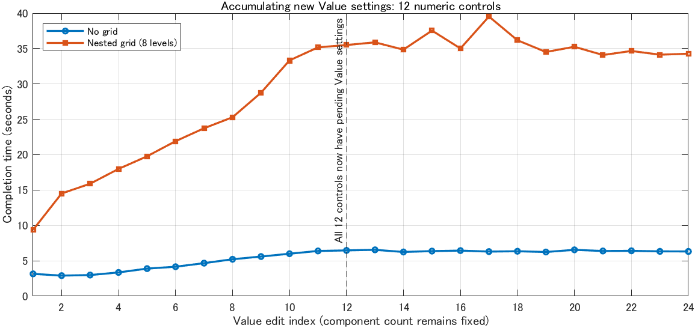

# 表示・追加・反復編集の処理時間調査

## 調査の位置付け

2026-10-20。ユーザーの選択に従い、アプリ本体を `4db803e` に固定して調査する。性能目標・操作感・可否の意味・ソース保持・履歴・必要な検証は変更せず、追加の軽量化は実装しない。元の実装計画の残工程である Preview 更新・部品追加・資源保持の優先順位を決める評価である。

測定対象はプロジェクト用に生成した汎用の AppBase 入力だけとする。個別の外部アプリの名前、ソース、パス、ハッシュ、個別計測値は記録しない。

## 結論と次の順序

一つの原因で全操作が重いという結論にはしない。優先するのは次の経路であり、元の実装計画の段階2・3・5・6の残工程を測定で並べ直したものとなる。

1. **新規設定が蓄積した変更：所有者別の候補を集約する。** 12部品だけでも解析が13／26回になり、部品数一定で時間の増加を再現した。挿入する構文編集と評価を分離し、一つの候補の生成・解析へまとめる。元位置・形式・全出現・constructor-only・applyAfter・型・範囲・途中の設定順、他の未保存設定の結果を保つ。
2. **大規模の選択・追加：コールバック位置の静的照合を索引化・共有する。** 追加内の可否更新で約32／43秒を確認した。欠損・重複・非直接初期化を同じく拒否し、操作可否の意味を保って走査を減らす。大きな親選択の専用プロファイルも実装前の切り分けに加える。
3. **既存Value・文字の確認と表示を局所化する。** 証明できる数値の設定順・制約を局所的に確認し、確定した実効状態で非Labelのネイティブ部品を再利用する。文字は独立したリテラルとして別の範囲を扱う。未知・所有不明・未対応の連動は従来経路へ戻す。既存のInspector面再利用を利用し、追加・階層・重ね表示も必要な更新範囲を見直す。
4. **残る表示用計算・複製・資源保持と境界推定を検証する。** 普通の反復の時間、private bytes、ソース評価、Native作成を分ける。fitの配置待ちとoverflowの安定後不一致を区別し、正しい境界と操作可否を維持する。ネイティブ部品の画面描画完了や、配置待ち中に次操作を重ねた時の時間は、今回の測定範囲を越えるため次の確認項目に残す。

責任範囲を追加で縮める方針、目標時間を緩める方針は採用していない。性能の採否・再プロファイル・相談の基準は[実装計画](PERFORMANCE_IMPLEMENTATION_PLAN.md)へ反映した。今回アプリ本体の軽量化実装には着手していない。

## 更新経路と観測範囲

プロパティ欄の変更は `inspectorValuesCommitted` からモデルへの確定前確認、履歴の記録、確定後の検証、`refreshViews` へ進む。現在の Preview 差分更新は独立した Label の一部プロパティに限られる。数値入力欄の Value は型・範囲等がモデル化された設定であり、Label の独立設定用の局所経路には入らず、全文の生成・再解析と Preview 全再作成を通る。

部品追加は Palette の通常の追加処理から `DocumentModel.insertComponent`、`refreshShell` へ進み、階層・Preview・Inspector・可否・重ね表示を更新する。Preview 内にもソース計画・実効状態の解決があるため、表示更新全体の時間をブラウザーの描画時間と同一視しない。

`refreshPreview` はネイティブ部品と HTML 重ね表示を作り直し、その場の境界情報を公開した後に配置確定の監視を予約する。監視は 50ms 間隔の fixedSpacing、最大40回で、ピクセルへ丸めた位置の署名が2回続けて同じなら停止して重ね表示を再計算する。40回だから常に2秒で完了するという意味ではなく、コールバック自身の処理・MATLAB のイベント待ちもかかる。

`Track boundaries do not agree with realized grid geometry.` は Grid の fit・固定・伸縮トラックと実測した部品矩形の制約を解いた結果が許容差に収まらない時の表示である。ソース検証の失敗や40回の待ち時間を表す文言ではない。境界が確定しない間は行列境界の編集を表示できない。

## 計測方法

`tests/performance/runYamadaUpdateDistribution.ps1` / `.m` を使用する。アプリ本体は変更せず、実際の Open、階層選択、Inspector の Value / Label の FontSize・Text、Palette の追加コールバックを呼ぶ。要求した値の反映と追加したモデル部品数を確認する。拒否された変更の時間は成功した変更の集計へ入れない。

同じ3パネル・数値入力欄・比較用 Label を配置し、グリッドなし、単層、8段の入れ子を比較する。fit を含む行列と、伸縮トラックのみの対照を分ける。起動、Open、選択、最初の変更、再編集、追加を区別する。

通常の完了時間は、コールバックの復帰だけでなく、配置監視の停止と最新 HTML revision の2フレーム描画通知までを含む。ネイティブ部品のブラウザー内の全描画完了や、物理ディスプレーの走査完了を直接測定した値ではない。差分更新で重ね表示の値が変わらなければrevisionも変わらず、前回の通知が成立する点にも注意する。JSON 保存・プロファイルの書出し・最終的な生成ソースの照合は操作時間から除く。

各操作は前の配置監視停止と重ね表示通知を待ってから次へ進む。配置待ち中に次のユーザー操作が入った場合の長さは、この分布から直接は分からない。通常分布は追加の監視タイマーを止めて取得する。別の追跡試験では50ms間隔の監視とイベント処理の区切りで公開済みの重ね表示を観測する。この間隔は処理で延び得るため、エラーの発生・復帰は観測時刻であり、正確な画面表示開始・終了を保証する値ではない。

プロファイルは通常の分布とは別の追加操作として取得し、包含時間は親子間で足し合わせない。所有する MATLAB プロセス群の CPU・private bytes・ハンドルを1秒間隔で記録する。資源の増加だけで恒久的なリークとは判定しない。

各出力の source-manifest、fixture-manifest、計測器の写し、進行記録、正常終了・拒否・未完了の区別を残す。通常操作300秒、プロファイル600秒、1構成3600秒を上限とする。打切り・計測器の不備による失敗は成功値へ繰り上げない。

## 表示開始と選択

以下はコールバック復帰だけでなく配置監視・重ね表示通知までの秒数である。Startupは別に記録し、Openへ加えない。初めての数値部品選択、比較Label選択、各追加前の親選択を区別する。親選択は新規設定・追加を先行させた文書の測定であり、初期状態の選択と同条件ではない。

| 数値部品数 / 構成 | Startup | Open | 数値部品の初選択 | Label選択 | 追加前の親選択 中央値 / 最大 |
|---|---:|---:|---:|---:|---:|
| 12 / グリッドなし | 13.497 | 4.782 | 2.337 | 3.427 | 2.470 / 3.991 |
| 12 / 単層 | 13.301 | 6.206 | 2.687 | 3.569 | 2.448 / 3.771 |
| 12 / 入れ子8段 | 14.524 | 7.506 | 3.403 | 3.991 | 3.699 / 4.597 |
| 50 / グリッドなし | 13.886 | 7.041 | 2.599 | 3.655 | 8.174 / 9.212 |
| 50 / 単層 | 13.446 | 10.128 | 3.227 | 3.869 | 8.259 / 11.284 |
| 50 / 入れ子8段 | 13.260 | 11.877 | 4.430 | 4.614 | 10.425 / 15.679 |

## 小規模の通常操作

数値入力欄12個と比較用Label1個を使用した。単層は各パネルに1個、入れ子は7個の外側Gridと各パネル内のGridを持ち、経路上のGridは最大8段となる。下表は起動・Open・選択・プロファイルを含まない。単位は秒。再編集は初回を除いた中央値と最小〜最大で、少数観測から安定したp95を保証しない。追加も最初の追加と残りを分ける。

| 構成 | 操作 | 最初 | 以降の中央値 | 最小〜最大 | 以降の件数 |
|---|---|---:|---:|---:|---:|
| グリッドなし | Value | 2.573 | 1.643 | 1.566〜1.987 | 11 |
| グリッドなし | Label.FontSize | 3.132 | 0.529 | 0.512〜0.545 | 3 |
| グリッドなし | Label.Text | 3.927 | 1.803 | 1.797〜1.931 | 3 |
| グリッドなし | Label追加 | 3.650 | 2.261 | 2.240〜2.367 | 5 |
| グリッドなし | 追加後のValue | 4.731 | 2.998 | 2.792〜3.076 | 3 |
| 単層 | Value | 5.295 | 3.340 | 3.173〜5.071 | 11 |
| 単層 | Label.FontSize | 4.918 | 1.122 | 1.116〜1.134 | 3 |
| 単層 | Label.Text | 5.866 | 3.426 | 3.321〜3.458 | 3 |
| 単層 | Label追加 | 6.054 | 4.054 | 3.760〜4.247 | 5 |
| 単層 | 追加後のValue | 8.233 | 5.622 | 5.505〜5.938 | 3 |
| 入れ子8段 | Value | 7.639 | 6.620 | 5.908〜7.319 | 11 |
| 入れ子8段 | Label.FontSize | 7.905 | 1.806 | 1.764〜2.022 | 3 |
| 入れ子8段 | Label.Text | 8.467 | 5.652 | 5.418〜5.757 | 3 |
| 入れ子8段 | Label追加 | 8.620 | 6.545 | 6.407〜7.074 | 5 |
| 入れ子8段 | 追加後のValue | 11.560 | 8.835 | 8.640〜8.854 | 3 |

追加前にはValue、FontSize、Textの変更がある。通常の追加6回に加え、別枠の追加プロファイル1回があり、「追加後のValue」は7部品増えた文書で測る。変更がない入力からの追加は別試験で区別する。全3構成で要求値・追加数・最終的な生成ソースの照合を通過し、最終のグリッド境界は利用可能だった。グリッドなしで境界がないことは異常としない。

## 代表プロファイルの内訳

以下は各構成のValue再編集1回の包含時間である。プロファイラーにより通常操作より長くなっており、通常分布の実時間へ置き換えない。確定処理・確定後検証・表示更新は同じ親コールバックの直接の子として示す。Preview・境界計算は表示側の内側にも含まれるので、列を横に足し合わせない。

| 構成 | 確定処理 | 確定後検証 | 表示更新 | Preview作り直し | 重ね表示（全呼出し） | Grid境界データ作成（全呼出し） |
|---|---:|---:|---:|---:|---:|---:|
| グリッドなし | 2.175 | 0.114 | 1.803 | 1.106 | 0.382 | 0.006 |
| 単層 | 2.928 | 0.261 | 2.621 | 1.912 | 0.697 | 0.163 |
| 入れ子8段 | 4.618 | 0.776 | 3.928 | 3.150 | 1.643 | 0.441 |

Valueは生成・再解析を繰り返す確定側と、全再作成する表示側の両方に負荷がある。境界データ作成だけを省いても全体の大部分は残る。確定後検証も独立した負荷であり、その維持をやめる判断にはしない。

追加のプロファイルでは、モデルへの挿入よりもrefreshShellが支配する。

| 構成 | モデルへの挿入 | refreshShell | その内側のPreview | Inspector | 階層 |
|---|---:|---:|---:|---:|---:|
| グリッドなし | 0.119 | 5.420 | 3.093 | 0.992 | 0.168 |
| 単層 | 0.141 | 7.752 | 5.210 | 0.955 | 0.199 |
| 入れ子8段 | 0.149 | 9.812 | 7.222 | 0.848 | 0.212 |

## 50部品での通常操作

数値入力欄50個とLabel1個を使用し、同じ寸法・手順で測った。Valueは6回、LabelのFontSize・Textは各4回、通常の追加は3回である。追加プロファイル1回も別枠で行い、追加後のValueは4部品増えた状態の4回である。以下は初回を除く完了時間の中央値（秒）。追加の再観測は2件、Valueは5件であり、規模差を調べる探索値とする。

| 構成 | Value | Label.FontSize | Label.Text | 追加 | 追加後のValue |
|---|---:|---:|---:|---:|---:|
| グリッドなし | 5.103 | 1.140 | 5.582 | 6.796 | 7.597 |
| 単層 | 9.920 | 2.656 | 9.394 | 12.290 | 14.413 |
| 入れ子8段 | 15.963 | 3.576 | 14.334 | 17.372 | 19.763 |

50部品・8段のValueプロファイルでは確定9.781秒、確定後検証1.963秒、表示7.265秒だった。表示内のPreview再作成は6.163秒、重ね表示は全呼出し計3.570秒、その内側にも含まれるGrid境界データ作成は0.542秒である。ここでも境界計算だけが全体を支配する構造にはなっていない。

同構成の追加プロファイルは、モデル挿入0.128秒に対してrefreshShell20.375秒、内側のPreview14.147秒だった。これを純粋な描画時間とは呼ばない。例えばグリッドなし50部品の追加では、Preview5.668秒の内側にPropertySourcePlan.planの3.351秒が含まれ、解析も1回行われた。先行するLabel.FontSizeの新規設定が残る文書の表示用評価も含まれる。

## 200部品の対照

数値入力欄200個とLabel1個、伸縮トラックのみで、両構成のsource figureを1000×1400に揃えた。絶対配置の入力欄がパネル領域外へ出ない条件である。12／50部品の1000×650・fit混在と寸法・トラック種別が異なるため、部品数だけの厳密な倍率比較とはしない。Value・FontSize・Text・追加は各2回で、下表の再観測は1件ずつに限る。

| 構成 | Value 初回 / 次回 | FontSize 初回 / 次回 | Text 初回 / 次回 | 追加 1回目 / 2回目 | 追加前親選択 1回目 / 2回目 | 追加後Value 初回 / 次回 |
|---|---:|---:|---:|---:|---:|---:|
| グリッドなし | 21.512 / 20.569 | 23.855 / 4.572 | 24.731 / 21.580 | 45.998 / 46.250 | 50.931 / 78.050 | 35.385 / 29.179 |
| 入れ子8段 | 69.831 / 67.240 | 62.066 / 16.165 | 60.241 / 60.413 | 90.838 / 88.389 | 72.157 / 106.803 | 86.380 / 83.911 |

起動・Openは別であり、Value初回にも含めていない。追加前の親選択は追加から分ける。追加プロファイル準備のための親選択は通常分布の観測数へ入れず、ケース全体の経過時間にのみ含む。

既存Valueの代表プロファイルは、グリッドなしの確定14.427秒・確定後検証1.422秒・表示8.505秒、8段の36.215秒・9.016秒・25.868秒だった。8段では重ね表示全体14.569秒に対しGrid境界データ作成0.861秒である。表示側も大きいが、境界データ作成だけを減らす案へ順位を絞らない。

追加の8段プロファイルでは、refreshShell96.176秒、可否更新43.164秒、canInsertGenerated4回計43.049秒、Preview49.125秒だった。大規模追加にはコールバックの静的照合と表示用評価・作成の両方が残る。選択の専用プロファイルは今回採っていないため、長い親選択の全時間を同じ関数だけへ割り当てる結論にはしない。次工程ではこの選択も再プロファイル対象にする。

## 同じ部品への100回のValue変更

比較用Labelの変更や追加を行わず、同じ数値入力欄の既存Valueを100回変更した。前半は初回を除いた20回、後半は最後20回で比較する。private bytesはその区間に観測した所有プロセス群の合計の中央値であり、履歴・MATLABの割当て・ブラウザー等を含む。

| 構成 | 完了 | 前半20回 秒 | 最後20回 秒 | ネイティブ数 | タイマー数 | private MiB 前→後 |
|---|---:|---:|---:|---:|---:|---:|
| グリッドなし | 100/100 | 1.637 | 1.462 | [170] | [0] | 1793.71→1878.78 |
| 入れ子8段 | 100/100 | 6.077 | 5.850 | [193] | [1] | 1862.23→1986.98 |

この条件で時間が単調に増える現象は再現しなかった。一方、オブジェクト数が一定でもprivate bytesの増加はある。これだけで恒久的なリークやその原因を断定しない。部品数は増やしておらず、同じプロパティの値を変えているため、追加・新規設定の蓄積とは別の結果である。履歴上限は既存の100件で、この試験は上限を超えた後の耐久性までは保証しない。

## 追加を連続した時の対照

数値入力欄12個の文書を開き、プロパティ変更を先行させずLabelを12個追加した。各条件には別枠の追加プロファイル1回もある。親を毎回選ぶ条件と、最初だけ親を選んで以後は新しいLabelを選択したまま追加する条件を分けた。通常の追加時間は、別に記録した親選択の時間を含まない。

| 構成 | 毎回親を選ぶ・2回目以降の中央値 秒 | 連続追加・2回目以降の中央値 秒 | 連続追加の最小〜最大 秒 |
|---|---:|---:|---:|
| グリッドなし | 1.864 | 1.268 | 1.131〜1.659 |
| 単層 | 3.359 | 2.837 | 2.586〜3.506 |
| 入れ子8段 | 6.114 | 5.426 | 4.809〜6.005 |

連続追加のプロファイルではInspectorのrebuildではなくrebindと値同期を通る。これは既存実装の効果であり、新しい軽量化実績とはしない。プロパティ変更なしの追加ではソース解析が発生せず、先行する新規FontSize設定が残る追加で解析を観測した条件とは異なる。Preview全再作成・階層・重ね表示・可否更新は依然残る。

## 部品数一定で新規Value設定を増やす

元ソースでValueを省略した数値入力欄12個を順に2巡して変更した。最初の巡回はValue=2を新規設定し、次は同じ設定を3へ変える。選択は別計測とし、部品数は一定である。新規設定の所有部品数はSourceSpanのないValueを数えて確認した。全24回と追加のプロファイル1回を完了し、生成後の全数値入力欄の値を照合した。

| 構成 | 新規所有者1部品目 秒 | 4部品目 秒 | 8部品目 秒 | 12部品目 秒 | 2巡目の中央値 秒 | 2巡目の最小〜最大 秒 |
|---|---:|---:|---:|---:|---:|---:|
| グリッドなし | 3.153 | 3.356 | 5.216 | 6.469 | 6.360 | 6.241〜6.551 |
| 入れ子8段 | 9.376 | 17.990 | 25.291 | 35.502 | 34.932 | 34.092〜39.532 |

既存Valueの同一部品100回と異なり、新規設定の所有部品数が増える間に時間が増え、12部品へ行き渡った後も遅さが残った。単純な操作回数やメモリだけでなく、未保存の新規設定を持つ入力の評価経路が原因となる。

12部品へ行き渡った後の代表プロファイルは次の通り。包含時間であり横に足し合わせない。

| 構成 | 確定処理 秒 | 挿入計画 秒 / 呼出し数 | parseText 秒 / 回数 | 表示更新 秒 | 文書複製 回数 |
|---|---:|---:|---:|---:|---:|
| グリッドなし | 7.251 | 5.867 / 13 | 6.022 / 13 | 2.410 | 28 |
| 入れ子8段 | 20.544 | 17.285 / 36 | 18.245 / 26 | 4.367 | 72 |

グリッドなしではRoundTripGenerator.generateが12部品分のPropertyInsertionPlanner.planを直接求め、候補の生成・解析を部品ごとに行っていた。最後の要求値確認の解析も含めて13回になる。入れ子ではPropertyInsertionPlanner.candidateから24回、確定前確認から1回、共同構成から1回の計26回を確認した。一方、この代表プロファイルの配置監視4回の計は0.903秒で、監視が40回まで終わらないことが長さの主因ではなかった。

同じ入力の結果を共有する既存策だけでは、所有者ごとに異なる候補を作る回数を減らせない。次の最優先は、設定の編集計画と評価を分離し、元位置・形式・全出現・型・範囲・途中の設定順を保って一つの候補へ集約する設計とする。検証を外す責任範囲縮小ではない。検証済み構成の取得で文書複製も繰り返すため、更新単位で私有の構成を一つだけ保持する案も、この経路の内訳と併せて評価する。

## 大規模の可否更新で残ったコールバック照合

200部品・グリッドなしの追加プロファイルでは、addComponentButtonPushedの包含時間52.268秒に対しrefreshEditCommandsが31.641秒だった。内部のCallbackSourceAnalyzer.canInsertGeneratedは4呼出し計31.533秒を占めた。Previewは16.693秒であり、この追加を描画主体とする結論は採用しない。

canInsertGeneratedは、解析済み部品の各Creation.StartOffsetを全SourceStatementのStartOffsetからarrayfunとfindで探し、一意な一致とlayout.Directを確認している。このプロファイルでは比較用関数が677,320回呼ばれた。Callback挿入位置の確認がCopy/Cut等の可否更新にも使われるため、操作の度に大きな静的照合が残っている。

次の案は、開始位置の一意性を保持した索引と、同じ入力・解析済み部品集合・layoutの確認結果の共有である。重複位置、欠けた位置、直接初期化でない位置を同じく拒否し、可否の意味を保ったまま走査回数を減らす。今回の計画では、将来のCallback追加可否を可否更新から外すといった保証・責任の変更は、この内部改善と区別する。

## 境界不一致の追跡

公開済み重ね表示の状態を追った別試験では、Value・追加・追加後Valueの全再作成で一時的な不一致を観測した。同じfixtureのLabel.FontSize・Textの差分更新では観測しなかった。Labelは伸縮行で列をまたぐ配置であり、全てのfit構成や全コントロールへの一般化はしない。

| 構成 / 操作 | 観測数 | 不一致の観測から利用可能になるまで 秒 |
|---|---:|---:|
| 単層 / Value | 3 | 0.616〜0.890 |
| 単層 / add | 2 | 0.748〜0.927 |
| 単層 / Value-after-add | 3 | 1.290〜1.309 |
| 入れ子8段 / Value | 3 | 1.395〜1.440 |
| 入れ子8段 / add | 2 | 1.219〜1.389 |
| 入れ子8段 / Value-after-add | 3 | 1.562〜1.899 |

追跡は通常分布と別に扱う。監視を軽くした単層のValue再編集2回は3.464・3.389秒で、通常の再編集中央値3.340秒に近かった。入れ子の追跡は7.363・7.573秒で通常より長く、観測区間を通常操作の厳密な表示時間へ置き換えない。通常の配置監視は概ね数回で停止し、最大40回の消費を遅さの主因とする根拠は得られていない。

## 配置待ちと、fitが収まらない時の境界推定

50部品・8段の追跡では、Value、追加、追加後Valueで不一致を観測してから復帰するまで2.652〜3.084秒だった。全て復帰し、最終状態も利用可能だった。監視ありの操作全体はValue19.104／19.545秒、追加18.195秒であり、その全時間を境界の待ちへ割り当てない。

別の200部品・8段のストレス入力は1000×650の面にfitと伸縮を混在させた。最初の部品選択時点から不一致になり、Value変更・配置監視4回の終了・2秒のidle後も利用不可だった。これは待ちが長いだけのケースと異なる。

アプリのgeometryキャッシュを介さず、同じ入力を新しいRendererへ描画してBuilderを毎回直接呼ぶ追試を行った。50部品は初期の不一致後に利用可能になり、6秒時点でfit・固定の最小高さと間隔の合計294.891px、利用可能488px、伸縮に残る193.109pxだった。200部品は6.5秒時点でも不一致で、同合計1114.031pxに対し利用可能488px、残りが−626.031pxだった。元のアプリに残った古いキャッシュだけを原因とする説明は成立しない。

Builderはfit・固定・伸縮・実測矩形を方程式にし、伸縮トラックを含む時は内側の高さから間隔を引いた合計へ合わせる。上のoverflowでは非負の伸縮高さへ整合できず、不一致となる。ネイティブ配置が安定しても境界を推定できない条件である。この文言を初期化の型・設定順のエラーやValue変更の拒否と同一視しない。

次の表示工程では、配置待ち、安定後に推定できる状態、overflow等で推定できない状態を区別する。overflowを扱う境界再構築は、ネイティブのスクロール範囲と子矩形に基づいて別途設計・検証する。エラー文言を消すだけ、過去の境界を別世代へ使い回すだけの案は採用せず、不確かな間の行列境界操作を保護する。

## 次工程を決める際の前提

- 数値入力欄のValueは、現在の独立したLabel数値用の局所経路へ入らない。型・Limits・AllowEmpty・丸め・境界包含条件と、実際の設定順を扱う既存の数値モデルがある。軽量化では、この条件を維持した局所的な確認を検討する。最終状態のLimitsだけを見る方法では、途中の設定でエラーになるケースを保証できないため、全出現と設定順を含める。
- Valueの表示更新は、まず既存のモデル確定で得た既知の実効状態を使い、同じ型のネイティブ部品へ必要な値を適用できる範囲を検討する。Labelだけの現在の差分更新を全Valueへ一括で広げる判断はしない。Gridのfit・古い世代のイベント・未知の連動時の保守的経路を維持する。
- 追加では、モデルへの挿入、表示用の生成・解析、ネイティブ部品作成、階層、Inspectorを分ける。Inspectorの同一面の再利用は既に実装済みである。親を毎回選択して種類が切り替わる時の再作成を、同じ型の連続追加でも常に起こる負荷とみなさない。
- 100回の同一部品の反復、変更対象を増やす編集列、部品追加を区別する。ネイティブオブジェクト数、ブラウザー等を含むprivate bytes、時間の傾向も別の指標として扱う。

## 計測器の校正と別のソース生成不具合

本計測には、型宣言を持つ汎用fixtureの成功した実行だけを採用した。初期の試運転では、HTML.DataにPostSet監視を付けられないというMATLABの制約、入れ子関数内のargumentsブロックが使えないという計測器の構文不備、監視の都度findallを実行した時の過大な負荷があった。失敗・中断した出力は残し、本計測の分布へ混ぜない。監視は使い捨てHTMLハンドルを再作成時だけ取得し直す方式へ修正した。

また、型宣言のない汎用入力では、Paletteの追加自体はモデルに反映されるが、以後のValue変更や最終生成が拒否・失敗する別不具合を再現した。スタックはRoundTripGenerator.additionEditsからindentのextractBeforeに至り、宣言位置を取得できない入力の位置処理に問題がある。型宣言を持つ入力で同じ追加と再編集・生成照合が通ることを確認した。これは今回の一時的な境界不一致の原因とは扱わず、未修正の生成・追加の整合性の課題として分ける。入力の既存の宣言形式とソースを保った修正、および生成不能な状態を受理しない条件を別に検証する。性能改善の実績には数えない。

## 再現・監査・検証

採用した22ケースは全て独立した所有MATLABプロセスで正常終了し、要求値・追加数・最終生成ソースの照合を通過した。全ケースのproduction source 138ファイルが固定した4db803eの作業内容と一致した。source／fixture manifest、計測器の写し、進行記録、通常値、raw profileとJSON、1秒間隔の所有プロセス資源を保存した。アプリの変更と、計測器の追加・監視の校正を区別する。

採用出力はtestResults/performance以下のupdate-small-d、update-trace12-b、update-scale50、update-repeat100、update-add12、update-add-consecutive12、update-new-values12、update-scale200-tall、update-trace50、update-fit-overflowの20261020系列である。update-distribution-audit-20261020.jsonが22/22完了・本体不一致0を記録する。update-verification-20261020以下に独立境界検証、静的検査、関連テストの結果を保存した。古い小さい編集面の200部品試運転は中断して除外し、1400の両構成を別系列で取得した。

計測用MATLABソース2ファイルの静的指摘は0件、既存のPerformanceViewTestとGridLayoutOverlayDataBuilderTestは17件全て合格、失敗・未完了0件だった。アプリ本体が固定された関連検証であり、全プロジェクトテストを今回やり直したという意味にはしない。最終の計測器調整は未計測領域での配列拡張注記と、probeの等価なスカラー判定のみで、本体・計測アルゴリズム・既存データを変更しない。

主要なコード根拠は、[RoundTripGenerator](+macd/+source/RoundTripGenerator.m)の所有者ごとの挿入計画、[PropertyInsertionPlanner](+macd/+source/PropertyInsertionPlanner.m)のevaluate／candidate、[CallbackSourceAnalyzer](+macd/+source/CallbackSourceAnalyzer.m)のcanInsertGenerated、[PreviewRenderer](+macd/+ui/PreviewRenderer.m)のLabelに限る差分更新、[GridLayoutOverlayDataBuilder](+macd/+ui/GridLayoutOverlayDataBuilder.m)の実測境界の整合性検査、[yamada](yamada.m)のrefreshViews／refreshShell／配置監視である。
