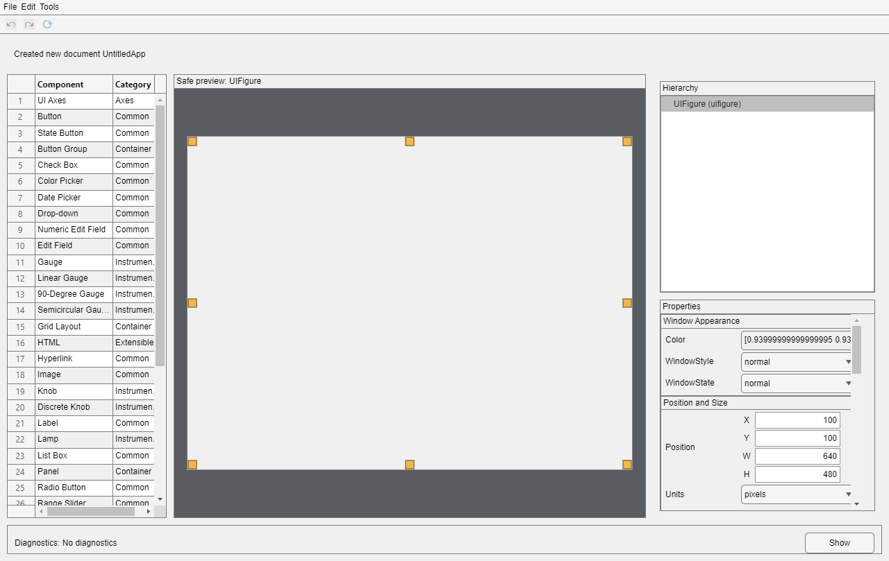
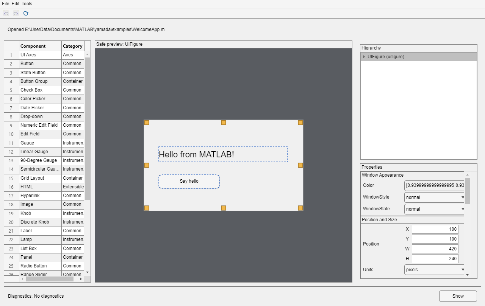

# Getting Started with yamada

For users new to yamada, this guide covers installation, a first edit, updates, and removal.

`yamada` edits MATLAB GUI applications stored as ordinary `.m` class files. Its canvas previews supported UI components without running your app or its callbacks.

## Install and launch

To install, download the `.mltbx` file from the [latest GitHub Release](https://github.com/NOBUTOKA/yamada/releases/latest). Open the downloaded file in MATLAB and follow the installation dialog. MATLAB R2023a through R2026b on 64-bit Windows is required, with a graphical session, JVM, and .NET support. R2026b installs no Java runtime, so install the MATLAB Support for OpenJDK add-on or another OpenJDK distribution first.

In the Command Window, enter:

```matlab
yamada
```

You can also select **yamada** in MATLAB's **Apps** tab. You do not need to add the source repository or its subfolders to the path after installing the Toolbox.

## Create your first app

1. Choose **File > New** and name your class `MyFirstApp`.
2. Add a **Label** and a **Button** from the palette.
3. Select the label and change its **Text** in the Property Inspector.
4. Move and resize the components on the canvas.
5. Choose **Tools > Validate** and review any messages, then **Tools > Diff Preview** to inspect the code.
6. Choose **File > Save** and save `MyFirstApp.m` in a writable folder of your own.
7. In MATLAB, change to that folder and enter `MyFirstApp` to run it. Close the app's window when finished.



## Edit the included example

The installed Toolbox includes the [WelcomeApp example](../examples/WelcomeApp.m). In MATLAB, locate it with:

```matlab
fullfile(fileparts(which("yamada")), "examples", "WelcomeApp.m")
```

1. Open that file using **File > Open** in yamada.
2. Select **GreetingLabel** in **Hierarchy** and change its **Text** or **FontSize**.
3. Select **GreetButton** and change its **Text** or position.
4. Review **Validate** and **Diff Preview**, then use **Save As** to save your own copy as `MyWelcomeApp.m` outside the installation folder.
5. Change to your saved folder in MATLAB and enter `MyWelcomeApp` to run it. The button's callback runs in the finished application; clicking the preview does not execute it.



Use **Undo** and **Redo** to step through edits. An asterisk in the window title means the document has unsaved changes. When switching documents or closing, use the Save, Discard, or Cancel prompt to decide what to keep.

## Update or remove

Before updating, save your work and close yamada. Install the newer `.mltbx` using MATLAB's installation dialog; releases retain the same Toolbox identifier. Keep your own applications outside the installed Toolbox folder.

To remove yamada, open **Home > Add-Ons > Manage Add-Ons**, find **yamada**, and choose **Uninstall**. MATLAB removes the Toolbox path and Apps entry when it uninstalls the Toolbox. Your separately saved applications remain your own files.

## Scope and help

Only MATLAB R2023a through R2026b on Windows are supported release targets. On R2026b, radio and toggle buttons outside a button group and `uiselectiongroup` are not supported yet. Apps must directly inherit from `handle`, own one `uifigure`, and use supported source syntax. `.mlapp` and AppBase inputs are outside the supported format. See the [specification](../SPECIFICATION.md) and [README](../README.md) for details.

Open a newer app with **File > Open** as usual. When the bundled catalogs identify a release mismatch, check the diagnostic at the top of the list. Unavailable components appear as read-only entries in the hierarchy and as labels in Safe Preview. You can edit supported settings and save while retaining unavailable features in the source. To run the saved app, use a MATLAB release that supports its features.

Keep your application under version control or make backups. Saving does not guarantee recovery from power loss or storage failure. Use [GitHub Issues](https://github.com/NOBUTOKA/yamada/issues) for bug reports; include MATLAB version, Windows version, and reproducible steps. Public contact: nobutoka@gmail.com.
