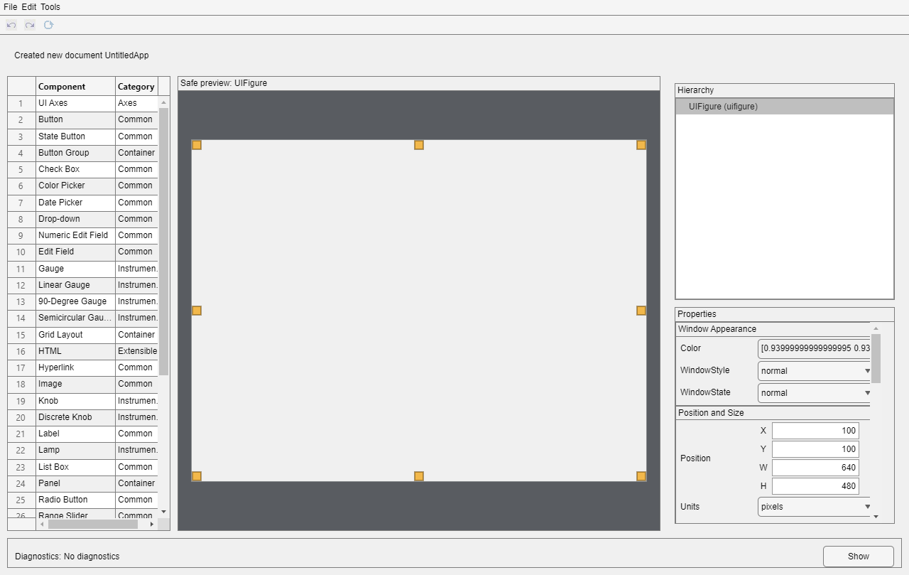
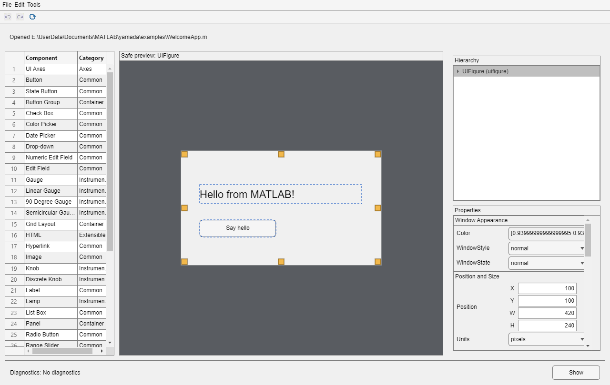

# Getting Started with yamada

`yamada` edits MATLAB GUI applications stored as ordinary `.m` class files. Its canvas previews supported UI components without running your app or its callbacks.

## Install and launch

Once version 1.0.0 is published, download `yamada-1.0.0.mltbx` from [GitHub Releases](https://github.com/NOBUTOKA/yamada/releases). Open the downloaded file in MATLAB and follow the installation dialog. MATLAB R2024a on 64-bit Windows is required, with a graphical session, JVM, and .NET support.

In the Command Window, enter:

```matlab
yamada
```

You can also select **yamada** in MATLAB's **Apps** tab. You do not need to add the source repository or its subfolders to the path after installing the Toolbox.

## Create your first app

1. Choose **File > New** and name your class `MyFirstApp`.
2. Add a **Label** and a **Button** from the palette.
3. Select the label and change its **Text** in the Property Inspector.
4. Move and resize the components on the canvas.
5. Choose **Tools > Validate** and review any messages, then **Tools > Diff Preview** to inspect the code.
6. Choose **File > Save** and save `MyFirstApp.m` in a writable folder of your own.
7. In MATLAB, change to that folder and enter `MyFirstApp` to run it. Close the app's window when finished.



## Edit the included example

The installed Toolbox includes the project-owned [WelcomeApp example](../examples/WelcomeApp.m). In MATLAB, locate it with:

```matlab
fullfile(fileparts(which("yamada")), "examples", "WelcomeApp.m")
```

1. Open that file using **File > Open** in yamada.
2. Select **GreetingLabel** in **Hierarchy** and change its **Text** or **FontSize**.
3. Select **GreetButton** and change its **Text** or position.
4. Review **Validate** and **Diff Preview**, then use **Save As** to save your own copy as `MyWelcomeApp.m` outside the installation folder.
5. Change to your saved folder in MATLAB and enter `MyWelcomeApp` to run it. The button's callback runs in the finished application; clicking the preview does not execute it.



Use **Undo** and **Redo** to step through edits. An asterisk in the window title means the document has unsaved changes. When switching documents or closing, use the Save, Discard, or Cancel prompt to decide what to keep.

## Update or remove

Before updating, save your work and close yamada. Install the newer `.mltbx` using MATLAB's installation dialog; releases retain the same Toolbox identifier. Keep your own applications outside the installed Toolbox folder.

To remove yamada, open **Home > Add-Ons > Manage Add-Ons**, find **yamada**, and choose **Uninstall**. Removal should also remove the Toolbox path and Apps entry. Your separately saved applications remain your own files.

## Scope and help

Only MATLAB R2024a on Windows is a supported release target. Apps must directly inherit from `handle`, own one `uifigure`, and use supported source syntax. `.mlapp` and AppBase inputs are outside the supported format. Some properties are read-only, and the preview may differ from a running application. See the [specification](../SPECIFICATION.md) and [README](../README.md) for details.

Keep your application under version control or make backups. Saving stages complete output before replacing an existing file, but it does not guarantee recovery from power loss or storage failure. Use [GitHub Issues](https://github.com/NOBUTOKA/yamada/issues) for bug reports; include MATLAB version, Windows version, and reproducible steps. Public contact: nobutoka@gmail.com.
